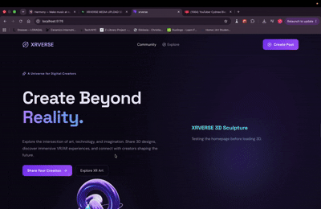

## XRVERSE — An Immersive Creative Community

XRVERSE is an interactive community platform where digital artists, 3D creators, VR/AR enthusiasts, and designers can share their creations, discover artwork, and participate in creative discussions.

Built with React, Vite, Supabase, Three.js, and React Three Fiber, XRVERSE combines a traditional discussion forum with an immersive digital art gallery.

### Features

- Create posts with titles, descriptions, and categories.
- Upload images directly from a computer or device.
- Upload GLB 3D models without using external hosting links.
- Rotate, zoom, and explore 3D models interactively.
- Browse a community feed with search, filters, and sorting.
- Upvote posts and leave comments.
- Edit and delete posts.
- Discover images, models, and animations in the Explore Gallery.
- Store posts and uploaded artwork with Supabase.

### Technologies Used

- React and Vite
- JavaScript and CSS
- React Router
- Supabase Database, Authentication, and Storage
- Three.js and React Three Fiber
- Drei
- Motion
- Lucide React

## Video Walkthrough

Here's a walkthrough of the XRVERSE application:

### Future Improvements

- Creator profiles and personalized portfolios.
- Improved account-based ownership and permissions.
- Drag-and-drop uploading and richer preview controls.
- Stronger spam prevention and upload security.
- Expanded support for animations and immersive VR/AR experiences.

# React + Vite

This template provides a minimal setup to get React working in Vite with HMR and some ESLint rules.

Currently, two official plugins are available:

- [@vitejs/plugin-react](https://github.com/vitejs/vite-plugin-react/blob/main/packages/plugin-react) uses [Oxc](https://oxc.rs)
- [@vitejs/plugin-react-swc](https://github.com/vitejs/vite-plugin-react/blob/main/packages/plugin-react-swc) uses [SWC](https://swc.rs/)

## React Compiler

The React Compiler is not enabled on this template because of its impact on dev & build performances. To add it, see [this documentation](https://react.dev/learn/react-compiler/installation).

## Expanding the ESLint configuration

If you are developing a production application, we recommend using TypeScript with type-aware lint rules enabled. Check out the [TS template](https://github.com/vitejs/vite/tree/main/packages/create-vite/template-react-ts) for information on how to integrate TypeScript and [`typescript-eslint`](https://typescript-eslint.io) in your project.
