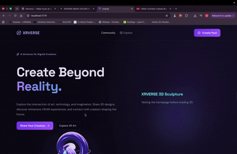

## XRVERSE — An Immersive Creative Community

XRVERSE is an interactive community platform where digital artists, 3D creators, VR/AR enthusiasts, and designers can share their creations, discover artwork, and participate in creative discussions.

Built with React, Vite, Supabase, Three.js, and React Three Fiber, XRVERSE combines a traditional discussion forum with an immersive digital art gallery.

XRVERSE is a full-stack web application where digital
artists, 3D creators, and VR/AR developers can discover,
share, and manage creative projects.

The platform combines a React community experience with
interactive 3D artwork, creator authentication, artwork
management, and privacy-aware publishing.

## Live Application

**Website:** https://xrverse-creative.netlify.app/

## Project Overview

Digital creators often work across separate platforms to
share their artwork, showcase 3D models, and interact with
other creators.

XRVERSE brings these experiences together in one creative
community designed around immersive digital content.

Users can browse public work, explore 3D creations,
register as creators, and manage their own artwork.

## Key Features

### Authentication and Creator Accounts
- Email/password registration and login
- Google OAuth authentication through Supabase
- Password recovery
- Creator profile and profile editing
- Guest browsing without registration

### Creative Community
- Create, view, edit, and delete posts
- Search and explore public creations
- Filter artwork by media type
- Comment and upvote as a registered user
- Navigate between community posts and artwork

### Interactive 3D Experiences
- Display supported 3D models
- Rotate and explore models using Three.js
- Responsive visual gallery
- Support for images and 3D media

### Personal Artwork Management
- My Artwork dashboard
- Public and private artwork
- Search and filter personal creations
- Manage posts owned by the signed-in creator

### Privacy and Security
- Supabase Row Level Security (RLS)
- Owner-based editing and deletion
- Protected private artwork
- Authenticated media uploads
- Separate public and private media storage
- Secure authentication using Supabase Auth

## Technology Stack

| Category | Technology |
|----------|------------|
| Frontend | React, JavaScript, Vite |
| Routing | React Router |
| UI Animation | Motion |
| Icons | Lucide React |
| 3D Rendering | Three.js, React Three Fiber, Drei |
| Backend | Supabase |
| Database | PostgreSQL |
| Authentication | Supabase Auth, Google OAuth |
| File Storage | Supabase Storage |
| Hosting | Netlify |
| Version Control | Git, GitHub |

## Application Architecture

XRVERSE uses a React single-page application connected
to Supabase services.

- React manages the user interface and application state.
- React Router handles navigation between pages.
- Supabase Auth manages registration, login, and sessions.
- PostgreSQL stores community posts and related data.
- Row Level Security enforces database access policies.
- Supabase Storage manages uploaded artwork files.
- React Three Fiber and Three.js render 3D models.
- Netlify hosts the production frontend.

## Security Design

XRVERSE uses authorization policies in Supabase rather
than relying only on hidden interface buttons.

Registered creators can edit or delete posts they own.
Private posts and protected files are restricted through
database and storage access policies.

Public visitors can browse public content without
accessing private creator assets.

## Running Locally

### Requirements

- Node.js
- npm
- A configured Supabase project

### Installation

Clone the repository:

```bash
git clone https://github.com/favour-Onyinye/Project-8-XRVERSE-Final-Project.git
```

Open the project directory containing package.json:

```bash
cd Project-8-XRVERSE-Final-Project
```

Install dependencies:

```bash
npm install
```

Configure your frontend Supabase environment variables
according to your project's Supabase client configuration.

Never commit secret or service-role keys.

Start the development server:

```bash
npm run dev
```

Open the local URL displayed in the terminal.

A working Supabase database, storage buckets, and access
policies are required for backend-dependent functionality.

## Engineering Challenges

### Secure Content Ownership

Implemented owner-based access controls to ensure
creators can manage their own posts without granting
unrestricted edit or delete access to other users.

### Private Media

Configured private storage and signed media access to
support artwork that is not publicly available.

### Interactive 3D Content

Integrated React Three Fiber and Three.js to support
interactive viewing of 3D assets.

### Authentication and Deployment

Integrated Supabase authentication with Google OAuth,
configured authentication redirects, and deployed the
application through GitHub and Netlify.

## Future Improvements

- Expanded creator discovery and search
- More advanced 3D asset previews
- Improved accessibility and mobile usability
- Creator follow and collaboration features
- Automated end-to-end testing

## Author

Favour Onyinye

Software Engineering | Digital Art | XR Development

## Project Status

Deployed as a portfolio and learning project.

Live Website:
https://xrverse-creative.netlify.app/
```


## Application Screenshots

### Homepage


### Explore Gallery


### Interactive 3D Viewer


### Creator Profile


### My Artwork


### Authentication


## Video Walkthrough

Here's a walkthrough of the XRVERSE application:




## 3D Artworks
- https://github.khronos.org/glTF-Assets/model/CommercialRefrigerator
- https://github.khronos.org/glTF-Assets/model/CarConcept
- https://github.khronos.org/glTF-Assets/?utm_source=chatgpt.com
- https://github.com/KhronosGroup/glTF-Sample-Assets/tree/main/Models/Box?utm_source=chatgpt.com

### Future Improvements

- Creator profiles and personalized portfolios.
- Improved account-based ownership and permissions.
- Drag-and-drop uploading and richer preview controls.
- Stronger spam prevention and upload security.
- Expanded support for animations and immersive VR/AR experiences.

# React + Vite

This template provides a minimal setup to get React working in Vite with HMR and some ESLint rules.

Currently, two official plugins are available:

- [@vitejs/plugin-react](https://github.com/vitejs/vite-plugin-react/blob/main/packages/plugin-react) uses [Oxc](https://oxc.rs)
- [@vitejs/plugin-react-swc](https://github.com/vitejs/vite-plugin-react/blob/main/packages/plugin-react-swc) uses [SWC](https://swc.rs/)

## React Compiler

The React Compiler is not enabled on this template because of its impact on dev & build performances. To add it, see [this documentation](https://react.dev/learn/react-compiler/installation).

## Expanding the ESLint configuration

If you are developing a production application, we recommend using TypeScript with type-aware lint rules enabled. Check out the [TS template](https://github.com/vitejs/vite/tree/main/packages/create-vite/template-react-ts) for information on how to integrate TypeScript and [`typescript-eslint`](https://typescript-eslint.io) in your project.
